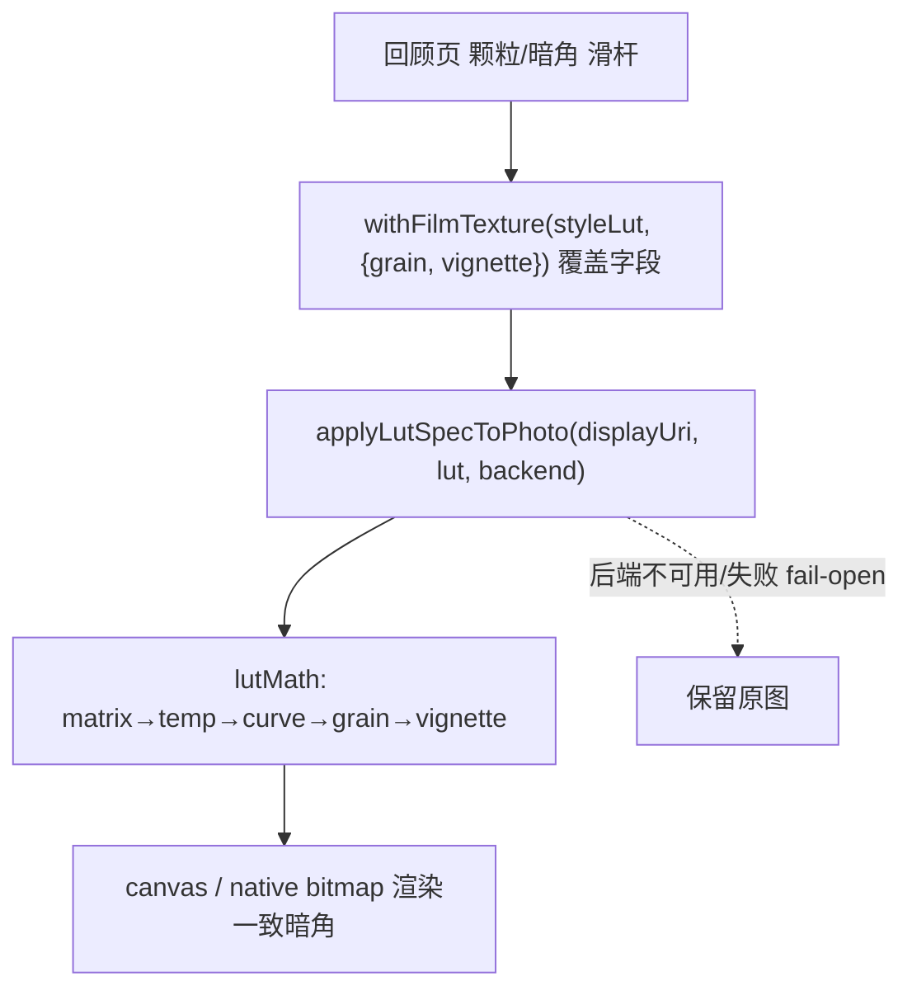

# 胶片质感自定义（颗粒/暗角）

Feature Name: film-texture
Updated: 2026-11-24

## Description

把固定 8 套风格变成"风格 × 质感"组合空间。LutSpec 新增 `vignette`（0–1）字段；lutMath 在既有 matrix→temperature→curve→grain 管线后追加径向暗角衰减；canvas 与 Android 原生 bitmap 后端用同一公式渲染一致暗角。回顾页新增颗粒/暗角控件，把所选风格 LUT 的对应字段覆盖为滑杆值后重渲染预览，复用强度范式（0 关闭、1 足量）。fail-open 沿既有通路。

## Architecture



## Components and Interfaces

- `src/plugin/types.ts`：`LutSpec` 增加 `vignette?: number`（0–1）。
- `src/plugin/builtin/lutMath.ts`：`applyLutToImageData` 在 grain 后追加 vignette 径向衰减；导出 `vignetteFactor(nx, ny, amount)` 纯函数供单测。
- `src/lib/filmTexture.ts`：`withFilmTexture(lut, {grain, vignette})` 纯函数，返回覆盖质感字段的新 LutSpec（不 mutate 入参）。
- `src/lib/__tests__/filmTexture.test.ts` + `lutMath` 既有测试补 vignette 用例。
- `src/components/business/PhotoReview.tsx`：颗粒/暗角滑杆 + 重渲染。
- `modules/image-filter/.../ImageFilterModule.kt`：`apply` 增加 `vignette` 参数，同一径向公式。
- `src/plugin/builtin/nativeBackend.ts`：桥接层透传 `vignette`。

## Data Models

```ts
// LutSpec 新增
vignette?: number; // 0-1, 四角压暗幅度

// 质感控件状态
type FilmTexture = { grain: number; vignette: number }; // 各 0-1
```

## Correctness Properties

- `vignetteFactor`：中心（nx=ny=0）因子为 1（不变暗）；四角（|nx|=|ny|=1）因子最小；amount=0 时因子恒为 1。
- `withFilmTexture`：不 mutate 入参；amount 夹取 0–1；缺省字段覆盖为给定值。
- 暗角只在亮度通道衰减，保持色相（乘性缩放 RGB）。

## Error Handling

- 后端不可用/渲染抛错：既有 fail-open 返回原图。
- vignette 缺省/越界：lutMath 视为 0（无暗角）；滑杆值夹取 0–1。

## Test Strategy

- Jest 纯单测：`vignetteFactor` 中心=1/四角最暗/amount=0 恒 1；`applyLutToImageData` vignette>0 压暗四角、vignette=0 不变；`withFilmTexture` 覆盖字段/不 mutate/夹取。
- 集成：回顾页滑杆后全量 jest/tsc/eslint 通过。
- 真机验证：`npx expo run:android` 后调滑杆看暗角/颗粒观感与 web 对齐。

## References

- LUT 引擎：`src/plugin/builtin/lutMath.ts`。
- Kotlin：`modules/image-filter/android/src/main/java/expo/modules/imagefilter/ImageFilterModule.kt`。
