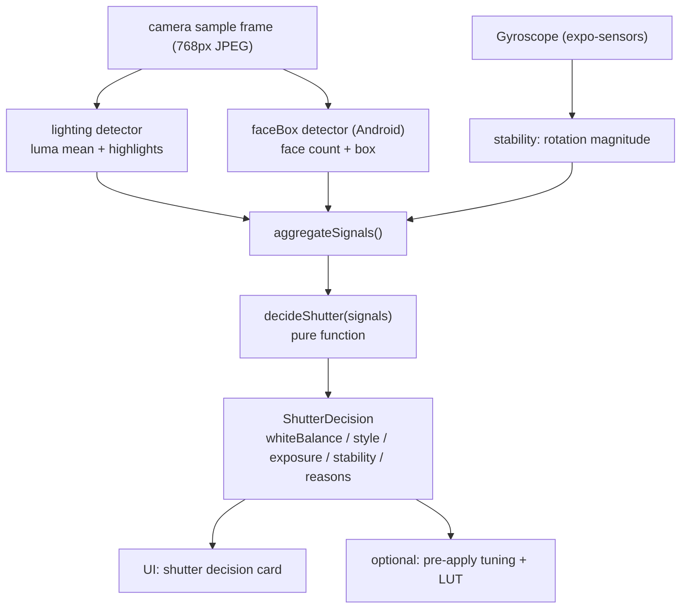

# 离线快门决策器

Feature Name: offline-shutter-decision
Updated: 2026-11-23

## Description

在按下快门那一刻，用端侧信号本地算出一组拍摄调整（白平衡、风格、曝光提示、手稳提示），不联网、不等模型。核心是一个纯函数 `decideShutter(signals): ShutterDecision`，输入聚合好的端侧信号，输出决策 + 可读原因。UI 在快门处展示决策，并可将其作为拍摄预调整落地（接进现有 `cameraTuning` / 风格 LUT）。

设计原则：**决策与采集解耦**。采集端只负责把信号喂进来（帧统计、人脸、陀螺仪），决策端是纯函数，可单测可复现。这样决策逻辑迭代不碰采集管线。

## Architecture



决策器不直接调用 detectors，而是消费"已聚合的信号"。聚合逻辑 `aggregateSignals` 负责跑 detectors + 读陀螺仪，产出 `ShutterSignals`。这样 `decideShutter` 保持纯函数。

## Components and Interfaces

### `ShutterSignals`（输入）

```ts
type ShutterSignals = {
  lighting: { mean: number; highlights: number } | null;
  faces: { count: number } | null;
  stability: { shake: number } | null; // 0=稳, 越大越晃
};
```

### `ShutterDecision`（输出）

```ts
type ShutterDecision = {
  whiteBalance: WhiteBalance;
  style: CameraStyle;
  exposure: { level: 'dark' | 'normal' | 'bright'; hint: string };
  stability: { level: 'stable' | 'shaky' | 'unknown'; hint: string };
  reasons: string[];
};
```

### `decideShutter(signals: ShutterSignals): ShutterDecision`

纯函数。规则（阈值集中、可调）：

- 暗光：`lighting.mean < 50` → exposure `dark`，建议补光；建议偏暖提亮风格。
- 过曝：`lighting.highlights > 0.15` → exposure `bright`，建议降曝光/避强光。
- 之间 → `normal`。
- 人像：`faces.count >= 1` → 建议人像风格（除非暗光更强时让位给提亮风格）。
- 手抖：`stability.shake > 0.9` → `shaky`，提示稳住；`<= 0.9` → `stable`；`null` → `unknown`。
- 回退：维度缺失（null）时该维度取安全默认（当前风格 / auto 白平衡 / unknown），并在 reasons 里说明。

### `aggregateSignals(...)`（采集侧，非纯）

跑 detectors（复用 registry）+ 读最近陀螺仪读数，产出 `ShutterSignals`。放在 hook 侧，决策器不依赖它。

## Data Models

无持久化。`ShutterSignals` / `ShutterDecision` 均为值对象。阈值定义为常量，便于真机标定后调整。

## Correctness Properties

1. **纯函数可复现**：相同 `ShutterSignals` → 相同 `ShutterDecision`。
2. **无网络**：`decideShutter` 不 import 任何网络 / 大模型模块。
3. **全维度降级**：任一信号为 null 时仍输出完整 `ShutterDecision`，缺失维度回退安全默认，不抛异常。
4. **原因可解释**：每个非默认建议都在 `reasons` 里有一条对应可读文案。
5. **曝光三态互斥**：`exposure.level` 恰为 dark/normal/bright 之一。

## Error Handling

- 信号缺失 → 维度回退默认，reasons 注明"未检测到 X，按默认处理"。
- 决策器永不抛异常；输入非法（如 NaN）按"缺失"处理回退。
- 落地预调整（接 cameraTuning）失败 → 决策仍展示，落地步骤单独 fail-open。

## Test Strategy

- `decideShutter` 纯函数单测：暗光 / 过曝 / 正常 / 人像 / 手抖 / 陀螺仪缺失 / 全缺失（全默认）各一例，断言各维度与 reasons。
- 暗光与人像同时命中时，验证风格让位优先级。
- 纯度断言：连续两次相同输入结果深度相等。
- 集成（后续）：hook 在快门处调用 aggregateSignals → decideShutter，展示决策。

## References

- `src/lib/aiGuidance.ts` — 现有云端决策路径（本特性与其并行，不替代）。
- `src/plugin/builtin/detectors/lighting.ts` — 帧亮度统计来源。
- `src/plugin/builtin/detectors/faceBox.ts` — 人脸信号来源。
- `src/lib/cameraTuning.ts` — 决策可落地的预调整目标。
