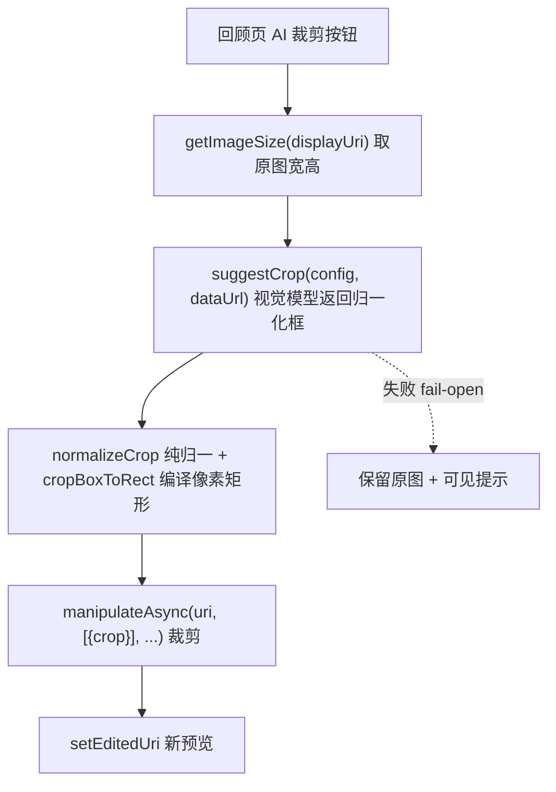

# AI 智能裁剪

Feature Name: photo-crop
Updated: 2026-11-24

## Description

回顾页"AI 裁剪"按钮：视觉模型分析成片，返回归一化裁剪框（centerX/centerY/width/height 各 0–1）+ 理由；客户端编译成像素 crop rect，经 `expo-image-manipulator` 的 `manipulateAsync` 裁剪，产出重构图后的新预览。纯参数、可单测、fail-open。补齐"评分 → 裁剪 → 调色"的旧照重塑闭环。

## Architecture



## Components and Interfaces

- `src/lib/photoCrop.ts`：纯归一 + schema + messages + `suggestCrop()` + `cropBoxToRect()` + `applyCropToPhoto()`。
  - `normalizeCrop(reading)`：夹取 0–1、保证 width/height ≥ MIN、理由占位。
  - `cropBoxToRect(box, imgW, imgH)`：归一化框 → 像素 `{originX,originY,width,height}`，clamp 到图内。
  - `buildCropMessages(dataUrl)` / `CROP_SCHEMA`。
  - `suggestCrop(config, dataUrl, signal, timeoutMs?)`：调模型并归一。
  - `applyCropToPhoto(uri, rect)`：`manipulateAsync` 裁剪（fail-open 由调用侧兜）。
- `src/lib/__tests__/photoCrop.test.ts`：归一 + rect 编译 + schema + messages 纯单测。
- `src/components/business/PhotoReview.tsx`：新增"AI 裁剪"按钮 + 理由文案 + 预览替换。

## Data Models

```ts
export type CropBox = { centerX: number; centerY: number; width: number; height: number }; // 各 0-1
export type CropRect = { originX: number; originY: number; width: number; height: number }; // 像素
export type CropSuggestion = { box: CropBox; rationale: string };
```

## Correctness Properties

- 归一化后 `0 <= centerX,centerY <= 1`；`MIN_CROP <= width,height <= 1`。
- rect 派生：`width_px = round(box.width * imgW)`，`originX = clamp(round(centerX*imgW - width_px/2), 0, imgW-width_px)`；高同理。
- 裁剪框恒在图内（clamp 保证）。

## Error Handling

- 模型失败/超时/解析失败：调用侧 catch，保留原图，`cropError` 显示提示。
- 字段越界/缺失：夹取 + 最小比例兜底；理由缺失占位。
- `manipulateAsync` 失败：保留原图，提示。

## Test Strategy

- Jest 纯单测：`normalizeCrop` 正常/越界夹取/缺字段/最小比例/理由占位；`cropBoxToRect` 居中/偏移/边界 clamp；`buildCropMessages` 含 image_url；`CROP_SCHEMA` required 完整；`suggestCrop` 解析。
- 集成：回顾页按钮后全量 jest/tsc/eslint 通过。
- 真机验证：`npx expo run:android` 后点裁剪看重构图预览。

## References

- 范式：`src/lib/photoScore.ts`。
- 裁剪：`expo-image-manipulator`（`cameraSample.ts` 已用）。
