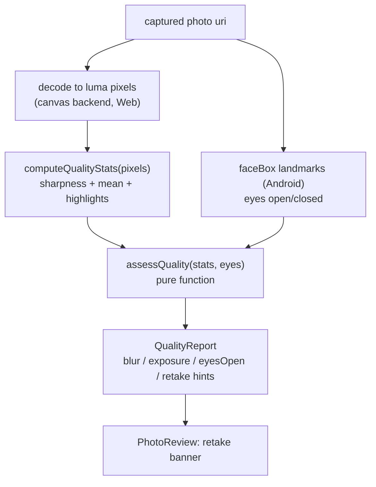

# 成片质量守护

Feature Name: photo-quality-guard
Updated: 2026-11-23

## Description

按下快门后对成片做端侧质量评估，明显废片（模糊 / 过曝 / 偏暗 / 闭眼）在回顾页提示重拍。核心是纯函数 `assessQuality(stats)`，输入像素统计（+ 可选闭眼信号），输出 `QualityReport`。与特性 1 同路线：判定与采集解耦，判定是纯函数可单测，采集（canvas 解码 / MLKit）在采集侧。

## Architecture



## Components and Interfaces

### `QualityStats`（像素统计，采集侧产出）

```ts
type QualityStats = {
  sharpness: number;   // 平均梯度，越高越清晰
  mean: number;        // 平均亮度 0-255
  highlights: number;  // 高光占比 0-1
};
```

### `QualityReport`（评估输出）

```ts
type QualityReport = {
  blur: boolean;
  exposure: 'dark' | 'normal' | 'bright';
  eyesOpen: boolean | null;   // null = 未评估
  shouldRetake: boolean;
  hints: string[];
};
```

### 纯函数

- `computeQualityStats(luma: Uint8Array): QualityStats` — 梯度用相邻像素差的平均绝对值（简化 Laplacian）；亮度/高光复用 lighting 思路。
- `assessQuality(stats: QualityStats | null, eyesOpen: boolean | null): QualityReport` — 阈值集中可调：
  - 模糊：`sharpness < BLUR_SHARPNESS`。
  - 偏暗：`mean < DARK_MEAN`；过曝：`highlights > BRIGHT_HIGHLIGHTS`；否则正常。
  - 闭眼：`eyesOpen === false` 才标记。
  - `shouldRetake = blur || exposure !== 'normal' || eyesOpen === false`。
  - stats 为 null → 跳过模糊/曝光，仅按闭眼给结论；全缺 → shouldRetake=false（不误报、不阻塞）。

### 采集侧

- `analyzePhotoQuality(uri)`（Web canvas）：加载成片→取 luma→`computeQualityStats`→`assessQuality`。非 Web / 解码失败 → `assessQuality(null, null)` 降级。
- 闭眼：Android faceBox landmarks 扩展（eyesOpen）。本迭代先把 `assessQuality` 的闭眼入口留好，采集端在 Android 上接 MLKit landmark。

## Data Models

无持久化。`QualityStats` / `QualityReport` 值对象。阈值常量集中定义。

## Correctness Properties

1. **纯函数可复现**：相同输入 → 相同 `QualityReport`。
2. **不阻塞保存**：任何评估失败都降级为不提示重拍，绝不阻止用户存图。
3. **维度可降级**：缺像素或平台不支持时跳过对应维度，按其余给结论。
4. **建议可解释**：每个不合格维度对应一条 `hints` 文案。

## Error Handling

- 解码失败 / 非 Web → `assessQuality(null, eyesOpen)`，模糊与曝光记为未评估，不误报模糊。
- 闭眼检测失败 → `eyesOpen = null`，跳过。
- `assessQuality` 永不抛异常。

## Test Strategy

- `computeQualityStats`：清晰图（高梯度）vs 纯色模糊图，断言 sharpness 差异。
- `assessQuality`：模糊 / 清晰、偏暗 / 过曝 / 正常、闭眼 / 睁眼 / 未评估、stats 为 null 降级、全缺不误报，各一例。
- shouldRetake 组合：任一不合格为 true；全合格为 false。

## References

- `src/lib/shutterDecision.ts` — 特性 1 同路线的纯函数范例。
- `src/plugin/builtin/detectors/lighting.ts` — 亮度/高光统计复用。
- `src/plugin/builtin/detectors/faceBox.ts` — Android 人脸检测，闭眼扩展点。
- `src/components/business/PhotoReview.tsx` — 重拍提示展示位置。
