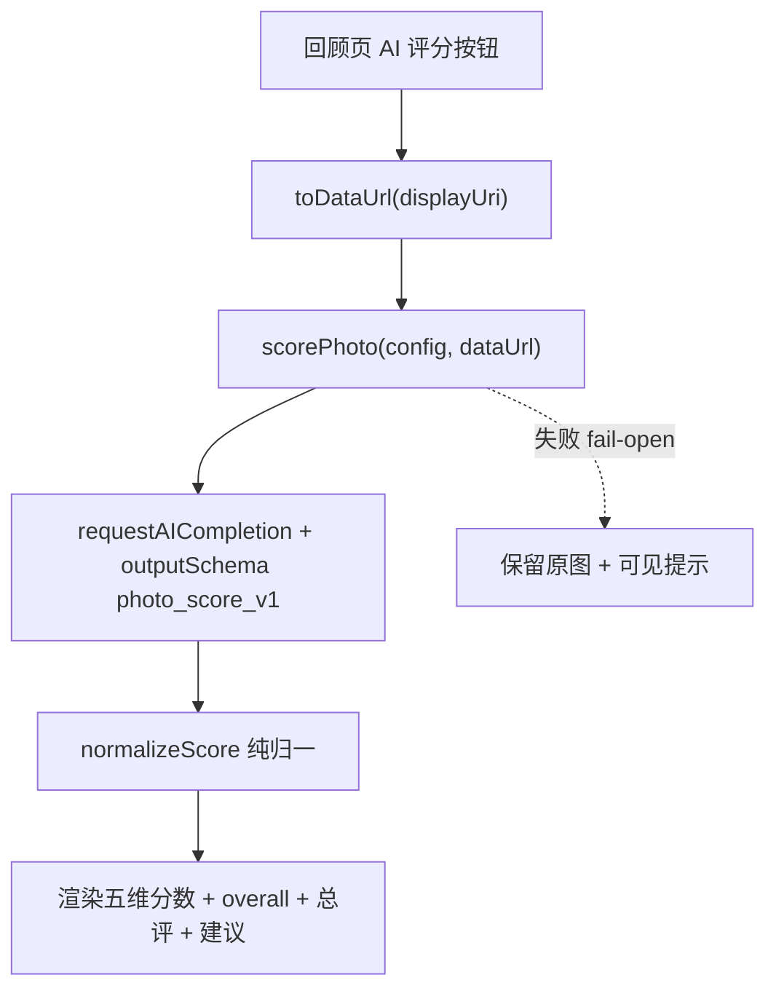

# AI 照片评分与点评

Feature Name: photo-score
Updated: 2026-11-24

## Description

回顾页"AI 评分"按钮：视觉模型对成片打五维分数（构图/光线/色彩/锐度/美学，各 0–100）+ 一句总评 + 1–3 条改进建议。复用 qwen-vl 通路 + JSON schema 约束；纯参数、可单测、fail-open。与像素守卫 `photoQuality.ts`（技术性"该重拍吗"布尔判断）互补——本模块是面向用户的美学解读。

## Architecture



## Components and Interfaces

- `src/lib/photoScore.ts`：纯归一 + schema + messages + `scorePhoto()`。
  - `SCORE_DIMENSIONS`：五维英文键常量。
  - `DIMENSION_LABELS`：英文键→中文展示标签。
  - `normalizeScore(reading)`：夹取分数、过滤建议、派生总分。
  - `buildScoreMessages(dataUrl)` / `SCORE_SCHEMA`。
  - `scorePhoto(config, dataUrl, signal, timeoutMs?)`：调模型并归一。
- `src/lib/__tests__/photoScore.test.ts`：归一 + schema + 消息纯单测。
- `src/components/business/PhotoReview.tsx`：新增"AI 评分"按钮 + 结果卡（五维条 + 总分 + 总评 + 建议列表）。

## Data Models

```ts
export const SCORE_DIMENSIONS = ['composition','lighting','color','sharpness','aesthetics'] as const;
export type ScoreDimension = typeof SCORE_DIMENSIONS[number];
export type ScoreReading = Record<ScoreDimension, number> & { summary: string; tips: string[] };
export type PhotoScore = {
  overall: number;                       // 0-100, 五维均值
  dimensions: Record<ScoreDimension, number>;
  summary: string;
  tips: string[];
};
```

## Correctness Properties

- 每维分数 `Number.isFinite` 且夹取在 0–100（整数）。
- overall = round(五维之和 / 5)，落在 0–100。
- tips 长度 0–3，全为非空字符串。
- summary 恒为非空字符串（缺失降级占位）。

## Error Handling

- 模型失败/超时/解析失败：调用侧 catch，保留原图，`scoreError` 显示提示；不阻塞选片/保存。
- 单维越界/非数字：夹取或降级 0；总评缺失：占位文案；建议非字符串/空：过滤。

## Test Strategy

- Jest 纯单测：`normalizeScore` 处理正常值/越界/非数字/空总评/非字符串建议/建议截断到 3；`buildScoreMessages` 含 image_url 与文本；`SCORE_SCHEMA` required 字段完整。
- 集成：回顾页新增按钮后全量 jest/tsc/eslint 通过。
- 真机验证：`npx expo run:android` 后点评分看分数卡。

## References

- 范式参考：`src/lib/sceneAi.ts`、`src/lib/sceneRecognition.ts`。
- 像素守卫（互补）：`src/lib/photoQuality.ts`。
