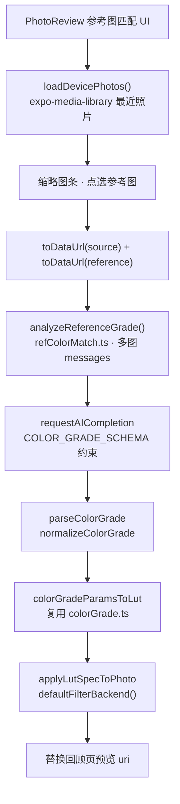

# 参考图复刻色调（AI 调色匹配）— 技术设计

Feature Name: reference-color-match
Updated: 2026-11-24

## Description

在回顾页新增"参考图匹配"：用户从设备最近照片中挑一张参考图，视觉模型同时看到原图与参考图，返回一组有界调色参数，编译成 LutSpec 复用现有 LUT 引擎套到原图上。复刻 Firefly "Generative Match" 的思路，但完全落在 Drama 已有的"模型出有界参数 → 纯函数编译 LutSpec → LUT 引擎渲染"范式内，无需分割/生成模型。

## Architecture

多图通路关键：`AIMessage.content` 是 `(text|image_url)[]`（`aiClient.ts:19`），一条 user 消息可同时携带原图与参考图两张 `image_url`，模型层零改动。

## Components and Interfaces

### `src/lib/refColorMatch.ts`（新增，AI 层）
- `REFERENCE_GRADE_SYSTEM_PROMPT`：以"调色师"角色，说明会看到两张图（第一张原图、第二张参考图），要求把参考图的色调套到原图，只返回五参数 JSON。
- `buildReferenceGradeMessages(sourceDataUrl, referenceDataUrl): AIMessage[]`：system + user（文本 + 原图 `image_url` + 参考图 `image_url`，顺序固定：原图在前、参考图在后）。
- `parseReferenceGrade(content)`：复用 `parseColorGrade` / `normalizeColorGrade`。
- `analyzeReferenceGrade(config, sourceDataUrl, referenceDataUrl, signal, timeoutMs=20000): Promise<ColorGradeParams>`：调 `requestAICompletion`（`outputSchema` = COLOR_GRADE_SCHEMA），返回 `ColorGradeParams`。

### `src/lib/refColorMatch.ts`（同文件，应用层）
- `applyReferenceGradeToPhoto(sourceUri, params, backend): Promise<string>`：`applyLutSpecToPhoto(sourceUri, colorGradeParamsToLut(params), backend)`，fail-open。与 `applyNlEditToPhoto` 同构。

### `src/components/business/PhotoReview.tsx`（改造）
- 新增状态：`refLoading` / `refList: AlbumItem[]` / `refUri: string | null` / `matching` / `matchError`。
- "参考图匹配"入口按钮：首次点击调 `loadDevicePhotos()` 填充缩略图条。
- 缩略图条（横向 ScrollView，固定高度）：点选设置 `refUri` 并高亮。
- "应用匹配"按钮（`refUri` 非空才可用）：`toDataUrl(displayUri)` + `toDataUrl(refUri)` → `analyzeReferenceGrade` → `applyReferenceGradeToPhoto(displayUri, params, defaultFilterBackend())` → `setEditedUri(out)`。叠加在当前预览（含一句修图）之上。
- 加载态禁重复提交；失败 `setMatchError('匹配未生效，请检查 AI 配置或换张参考图。')`。

## Data Models

复用 `ColorGradeParams` / `COLOR_GRADE_SCHEMA`（`colorGrade.ts`），不新增数据结构。参考图用 `AlbumItem`（`album.ts`，`{uri,title,tag}`）。

## Correctness Properties

- 模型只返回五个 [-1,1] 数值，经 `normalizeColorGrade` 钳制；非法/缺失项归 0。
- 原图 uri 永不被覆盖；匹配结果写入 `editedUri`，失败保留当前 `displayUri`。
- 未选参考图不发请求；模型请求期间 `matching` 为真、按钮禁用。
- 参考图顺序在 messages 中固定（原图 index0、参考图 index1），与 system prompt 描述一致。

## Error Handling

| 场景 | 行为 |
|---|---|
| 媒体库权限被拒 / 加载异常 | `loadDevicePhotos` 返回 `[]` → 列表空、提示不可用，fail-open |
| web / 无原生模块 | `loadDevicePhotos` 已在 web 返回 `[]`，入口隐藏或提示 |
| 模型失败 / 超时 / JSON 残缺 | catch → 保留预览图 + `matchError` 提示，原图无损 |
| 未选参考图点应用 | 前置校验 `refUri` 非空，不发起请求 |

## Test Strategy

- `refColorMatch.test.ts`（纯/AI 层，mock `aiClient`）：messages 构造断言两张图顺序与文本；`parseReferenceGrade` 边界钳制；`analyzeReferenceGrade` 成功/失败；`applyReferenceGradeToPhoto` 编译 LUT 并调 backend、fail-open。镜像 `colorGradeAi`/`nlEdit` 测试。
- `PhotoReview.test.tsx`（扩展）：mock `refColorMatch` + `media`，覆盖选参考图 → 应用匹配 → 预览替换；失败保留原图。
- 全绿门槛：`npx jest`、`npx tsc --noEmit`、`npx eslint .`。

## References

[^1]: `src/lib/colorGrade.ts` — ColorGradeParams / colorGradeParamsToLut / COLOR_GRADE_SCHEMA
[^2]: `src/lib/colorGradeAi.ts` — analyzeColorGrade 多图同构范本
[^3]: `src/lib/nlEdit.ts` — applyNlEditToPhoto / editPhotoFromInstruction 集成范本
[^4]: `src/components/business/PhotoReview.tsx` — 一句话修图 UI（接入点）
[^5]: `src/lib/media.ts` — loadDevicePhotos（参考图来源，依赖已装）
[^6]: `src/lib/aiClient.ts#L19` — AIMessage 多图 content 类型
